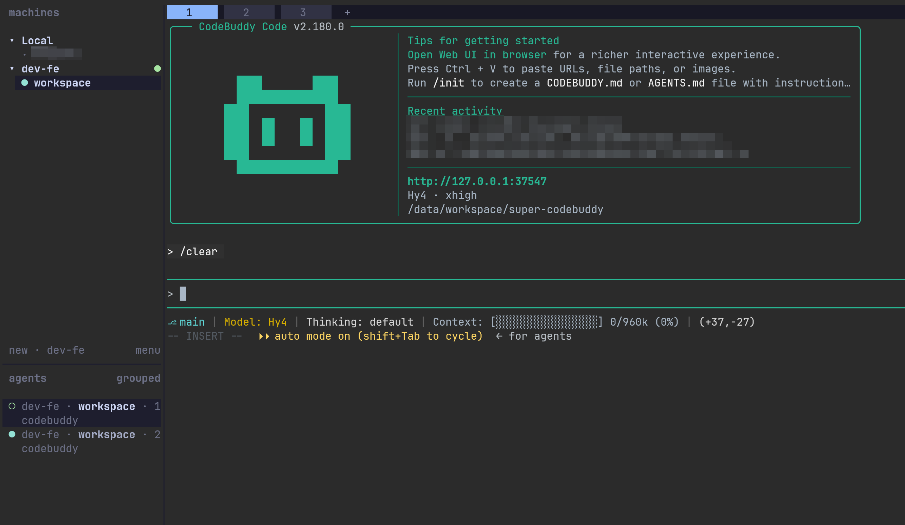

# herdr-adapter

[简体中文](README.md) · [English](README.en-US.md)

[](https://github.com/whinc/super-codebuddy/blob/main/plugin/.codebuddy-plugin/plugin.json)
[](https://github.com/whinc/super-codebuddy/actions/workflows/test.yml)

Let the Herdr sidebar show whether your CodeBuddy session is working, waiting for you, or idle — so you stop switching back to find it was waiting on a confirmation all along.



**Status:** Experimental. A community adapter, not affiliated with Herdr; it follows Herdr and CodeBuddy Mod API changes, issues answered best-effort. [MIT](LICENSE) licensed. This repository is a single-plugin marketplace, plugin name `herdr-adapter`.

## What it solves

Herdr reports state for the agents it knows, and CodeBuddy is not in `herdr agent start --kind` — so the pane stays `unknown` for a whole turn, and the part that actually costs you time never shows up: it is waiting for you. This [CodeBuddy Mod](https://www.codebuddy.cn/docs/cli/mods) reports the session's `working`, `blocked` and `idle` to the Herdr pane.

That is all it does: it does not start CodeBuddy, does not create a pane, and does not alter the turn. Events pass through unchanged, and a failed report never affects the turn. CodeBuddy's built-in hooks could do the same job, but every event would start a Node process; this Mod runs inside the CLI process and spawns herdr only when the visible state changes.

## Install

Requires [Herdr](https://herdr.dev) (tested 0.9.5; uses `pane report-agent`, `pane release-agent` and `pane read --source detection`) and CodeBuddy Code 2.183 or newer with Mods (beta, tested on 2.183.0; pre-answer PTC reporting relies on `classic.Notification` reaching Mods in 2.183 — 2.182 and older stay `working` through the wait). Node is only needed to run the tests.

Inside a CodeBuddy session:

```sh
/plugin marketplace add whinc/super-codebuddy
/plugin install herdr-adapter@super-codebuddy
```

Then start `codebuddy` **inside a Herdr pane**. New sessions load the plugin automatically; `/reload-plugins` applies it to the current one.

The adapter only works in a pane: `HERDR_ENV`, `HERDR_PANE_ID` and `HERDR_BIN_PATH` are injected by Herdr, and it reports only when all three are present.

## What you will see

The pane lists the session as `codebuddy`:

| Pane state | When |
| --- | --- |
| `idle` | Before the first turn, or after one ends; `codebuddy --resume <id>` picks it back up from the sidebar |
| `working` | A turn is in progress |
| `blocked` | A permission check, model question, plan approval, or a prose question at the end of a turn is waiting for you; `--message` says which |

Sub-agent turns are ignored: while the main turn runs, the pane is busy. A sub-agent's permission check still reports `blocked`, because it waits on the same person.

For how it decides and where the edges are, see [docs/how-it-works.md](docs/how-it-works.md).

## Limits

- It does not add CodeBuddy to `herdr agent start --kind`: that needs a Herdr binary update, and the [upstream PR](https://github.com/herdrdev/herdr/pull/4932) is unmerged.
- Only sessions started inside a Herdr pane are covered; CodeBuddy in a plain terminal reports nothing.
- `blocked` mostly comes from the engine's pre-wait notification; a prose question at the end of a turn comes from `turn.complete.answer`, the engine's reply text, so no screen read is involved (word list in `plugin/hooks/detect.ts`, so an unusual phrasing is missed). The Chinese approval strings are preventive, since the 2.183.0 TUI is English.
- Experimental: a Herdr or CodeBuddy Mod API change can break it.

## Development

`npm test` (Node >= 22.18). Sandbox rules, running a local copy, `plugin eval` and load-failure troubleshooting live in [AGENTS.md](AGENTS.md).

Terminology is in [GLOSSARY.md](GLOSSARY.md). The idea comes from [herdr-codebuddy](https://github.com/Ziy1-Tan/herdr-codebuddy).
