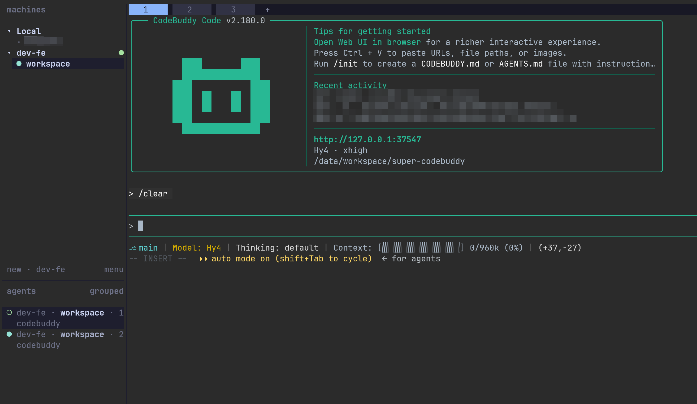
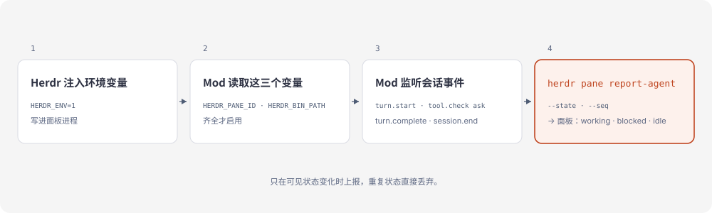

# herdr-adapter

[简体中文](README.md) · [English](README.en-US.md)

[](https://github.com/whinc/super-codebuddy/actions/workflows/test.yml)

Herdr 给自己支持的 agent 报状态，`herdr agent start --kind` 里列了二十来个，CodeBuddy 不在其中。它的面板整轮都是 `unknown`，等你切回去才发现它一直在等一条权限确认。这个 [CodeBuddy Mod](https://www.codebuddy.cn/docs/cli/mods) 把会话的 `working`、`blocked`、`idle` 报给 Herdr，面板就能回答这个问题。



**状态：** 0.1.0，实验性。社区适配器，与 Herdr 官方无关；跟随 Herdr 与 CodeBuddy Mod API 变动，issue 尽力回。MIT 许可。本仓库是一个单插件市场，插件名 `herdr-adapter`。

## 它是什么

一个 CodeBuddy Mod：由本仓库市场安装、加载进 CLI 进程的 TypeScript 钩子。它不是 Herdr 插件，也不会把 CodeBuddy 加进 `herdr agent start --kind`。

它对外只做两件事：CodeBuddy 所在面板每次可见状态变化，发一次 `herdr pane report-agent`；会话真正结束时，发一次 `release-agent`。它不启动 CodeBuddy，不创建面板，也不改动这一轮：事件原样放行，上报失败直接丢弃。

## 安装

需要 [Herdr](https://herdr.dev)（用到 `pane report-agent` 与 `pane release-agent`，实测 0.9.5）和带 Mods 的 CodeBuddy Code（beta，实测 2.181.0）。只有跑测试才需要 Node。

在 CodeBuddy 会话里执行：

```sh
/plugin marketplace add whinc/super-codebuddy
/plugin install herdr-adapter@super-codebuddy
```

然后在 Herdr 面板里启动 `codebuddy`：新会话会自动加载插件，`/reload-plugins` 让当前会话生效。不在面板里时适配器不工作，`HERDR_ENV`、`HERDR_PANE_ID`、`HERDR_BIN_PATH` 由 Herdr 注入，三个都齐了才会上报。

面板里会把这个会话列为 `codebuddy`：第一轮之前是 `idle`，运行中是 `working`，等你处理权限确认、或模型自己用 `AskUserQuestion` 问你时是 `blocked`。

## 为什么需要它

面板能报什么，由 Herdr 的检测列表决定。没有 CodeBuddy 这一项，一轮跑起来面板始终是 `unknown`，而真正费时间的 `blocked` 根本不会出现：那一轮停在那里，等你处理。

## 工作原理



Herdr 把 `HERDR_ENV`、`HERDR_PANE_ID`、`HERDR_BIN_PATH` 写进它启动的进程。Mod 在第一次钩子调用时读这三个变量，齐全才建 adapter。此后每个钩子只做观察，事件原样放行；状态可见地变了，才发一次 `herdr pane report-agent`，带上面板、状态和单调递增的 `--seq`。侧栏的状态由此而来，重启后还能用 `codebuddy --resume <id>` 把会话接回来。

### 面板显示什么

| CodeBuddy 事件 | 上报给 Herdr 的状态 |
| --- | --- |
| `session.start` | `idle`，附带会话 ID 与 `codebuddy --resume` 命令 |
| `turn.start` | `working` |
| `tool.check` → `ask` | `blocked`：有权限确认在等人处理 |
| `tool.call` → `AskUserQuestion` | `blocked`：模型自己的提问在等人回答 |
| `tool.call` 结算 | `working`：批准后清除 `blocked`，工具调用被拒绝也一样 |
| `turn.complete` | `idle` |
| `session.end`（`clear`、`resume`） | `idle`：进程比这次对话活得久 |
| `session.end`（其他情况） | 释放 agent |

子 agent 的 turn 循环被忽略：只要主轮还在进行，面板就算忙。但子 agent 的权限确认照样报 `blocked`，等的是同一个人。

## 为什么开销低

钩子跑在 CLI 进程里，每个事件都不另外启动 shell 或 Node 钩子进程。上报按状态去重，一轮里五十次工具调用只发一次 `working` 和一次 `idle`。上报也不被 await，这一轮从不等待 Herdr。

用 CodeBuddy 的 hooks（事件触发的外部脚本）实现同一件事，每个事件都要起一个 Node 进程，再由它调用 herdr，一轮五十次工具调用就是上百次进程启动。这个 Mod 只在可见状态变化时才 spawn 一次 herdr。

## 开发

需要支持 Mod 的 CodeBuddy Code（beta，实测 2.181.0）。钩子是 `plugin/hooks/` 下的 TypeScript，`npm test` 需要 Node >= 22.18。

```sh
npm test
```

`npm run eval` 用 `codebuddy plugin eval` 评估插件：两个用例（一轮普通对话、一次必须穿过 `tool.check` / `tool.call` 钩子的工具调用），各跑 3 轮，并与不带插件的基线对比。这是观察型插件，两侧分数必须一致，差一点就是缺陷。报告输出到 `plugin/evals/results/`。

想跑本地副本而不是市场版：

```sh
codebuddy --plugin-dir ./plugin
```

市场版和 `--plugin-dir` 装同一份时，日志会报 `Duplicate Mod identity`，留一个。

沙箱规则、验证与排查见 [AGENTS.md](AGENTS.md)。参考：[CodeBuddy Mods](https://www.codebuddy.cn/docs/cli/mods)、[Add Herdr support to your agent](https://herdr.dev/docs/add-herdr-support/)。

## 致谢

本项目的思路受 [herdr-codebuddy](https://github.com/Ziy1-Tan/herdr-codebuddy) 启发。

[herdrdev/herdr#4932](https://github.com/herdrdev/herdr/pull/4932) 请求 Herdr 官方支持 CodeBuddy，目前还没合并。合并之前，本项目是现阶段的替代方案；官方支持落地后，这个插件就可以退役了。
