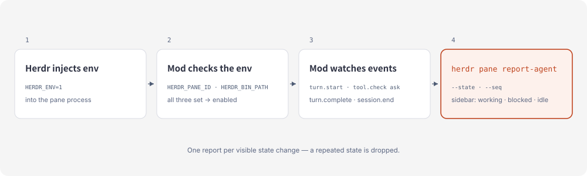

# herdr-adapter

[English](README.md) · [简体中文](README.zh-CN.md)

[](https://github.com/whinc/super-codebuddy/actions/workflows/test.yml)

Herdr reports the state of the agents it ships a detector for — `herdr agent start --kind` lists two dozen of them. CodeBuddy isn't one, so its pane has no state to show: it reads `unknown` for the whole turn, and you only find out it was waiting on a permission prompt when you switch back. This [CodeBuddy Mod](https://www.codebuddy.cn/docs/cli/mods) reports `working`, `blocked` and `idle` for the session to Herdr, so the pane answers that question for you.


**Status:** 0.1.0, experimental. Community adapter, not affiliated with Herdr — tracks Herdr and CodeBuddy Mod APIs; issues answered best-effort. MIT licensed. This repo is a one-plugin marketplace; the plugin is `herdr-adapter`.

## Why this exists

Herdr's detector list is the authority on what a pane can report. With no entry for CodeBuddy, the pane stays `unknown` while a turn runs, and `blocked` — the state that costs you time, because the turn is stopped until you answer — never appears at all.

## How it works



Herdr writes `HERDR_ENV`, `HERDR_PANE_ID` and `HERDR_BIN_PATH` into the process it starts. The Mod reads them on its first hook call and builds an adapter only if all three are present. From then on every hook is observation: the event passes through untouched, and a visible change becomes one `herdr pane report-agent` call carrying the pane, the state and a monotonic `--seq`. That call is what puts the state in the sidebar and keeps `codebuddy --resume <id>` for the next restart.

### What the pane shows

| CodeBuddy event | Reported to Herdr |
| --- | --- |
| `session.start` | `idle`, with the session id and a `codebuddy --resume` command |
| `turn.start` | `working` |
| `tool.check` → `ask` | `blocked` — a permission prompt is waiting on you |
| `tool.call` settles | `working` — clears `blocked` once approved, denial included |
| `turn.complete` | `idle` |
| `session.end` (`clear`, `resume`) | `idle` — the process outlives the conversation |
| `session.end` (anything else) | releases the agent |

Subagent turns are ignored — the pane stays busy while the main turn runs — but a subagent's permission prompt still reports `blocked`, because it waits on the same person.

## Why it is cheap

- **In-process.** Hooks run inside the CLI process, so no shell or Node hook process starts per event.
- **Edge-triggered.** Reports are deduplicated by state: fifty tool calls in one turn send one `working` and one `idle`, not a hundred.
- **Fire and forget.** Reports are never awaited; a turn doesn't wait on Herdr.

A fork-per-event hook spends a shell, a Node process and a herdr call on every tool call; this one spawns herdr only when the visible state changes.

## Development

Needs CodeBuddy Code with Mods (beta; verified on 2.181.0). The hooks are TypeScript under `plugin/hooks/`, and `npm test` needs Node >= 22.18.

```sh
npm test
```

`npm run eval` scores the plugin with `codebuddy plugin eval`: two cases (a plain turn, and a tool call that must survive the `tool.check` / `tool.call` hooks), three runs each, against a no-plugin baseline. The observer must score the same with and without it, so a non-zero delta is the bug. Its report lands in `plugin/evals/results/`.

To run a checkout instead of the marketplace install:

```sh
codebuddy --plugin-dir ./plugin
```

Loading that copy alongside the marketplace install logs `Duplicate Mod identity`; keep one of the two.

Sandbox rules, verification and troubleshooting: [AGENTS.md](AGENTS.md). References: [CodeBuddy Mods](https://www.codebuddy.cn/docs/cli/mods), [Add Herdr support to your agent](https://herdr.dev/docs/add-herdr-support/).

## Credits

The idea comes from [herdr-codebuddy](https://github.com/Ziy1-Tan/herdr-codebuddy).

[herdrdev/herdr#4932](https://github.com/herdrdev/herdr/pull/4932) asks Herdr to ship CodeBuddy support upstream. It is still open, so until it lands this adapter is the stand-in — once Herdr reports CodeBuddy natively, this plugin has nothing left to do.
