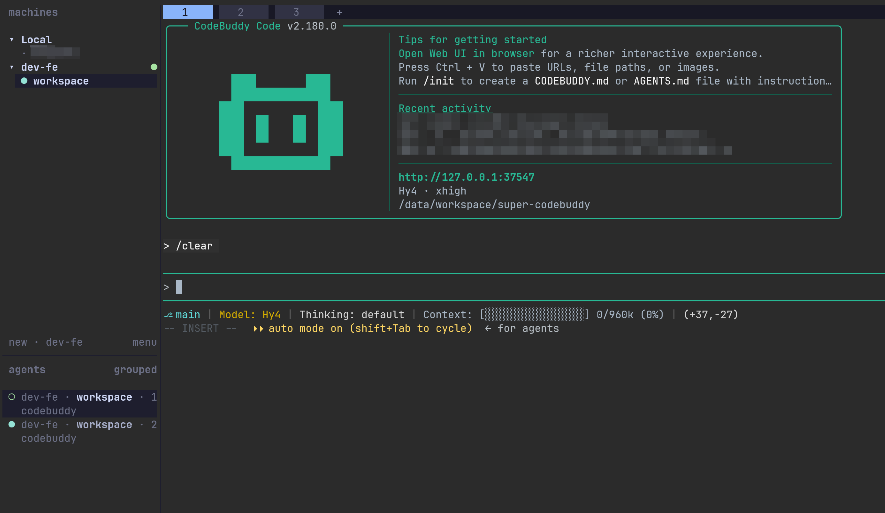
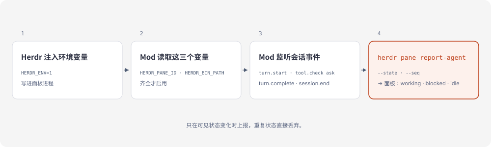

# herdr-adapter

[English](README.md) · [简体中文](README.zh-CN.md)

[](https://github.com/whinc/super-codebuddy/actions/workflows/test.yml)

Herdr 会给它支持的 agent 报状态——`herdr agent start --kind` 里列着二十来个。CodeBuddy 不在其中，所以它的面板没有状态可显示：整轮都是 `unknown`，等你切回去才发现它一直在等一条权限确认。这个 [CodeBuddy Mod](https://www.codebuddy.cn/docs/cli/mods) 把会话的 `working`、`blocked`、`idle` 报给 Herdr，让面板替你回答这个问题。



**状态：** 0.1.0，实验性。社区适配器，与 Herdr 官方无关——跟随 Herdr 与 CodeBuddy Mod API 变动，issue 尽力回。MIT 许可。本仓库是一个单插件市场，插件名 `herdr-adapter`。

## 为什么需要它

面板能报什么，以 Herdr 的检测列表为准。没有 CodeBuddy 这一项，一轮跑起来面板始终是 `unknown`；而真正费时间的 `blocked`——那一轮停在那里等你处理——根本不会出现。

## 工作原理



Herdr 会把 `HERDR_ENV`、`HERDR_PANE_ID`、`HERDR_BIN_PATH` 写进它启动的那个进程。Mod 在第一次钩子调用时读取这三个变量，齐全才建 adapter。此后每个钩子都只做观察：事件原样放行，只是可见状态变化时发一次 `herdr pane report-agent`，带上面板、状态和单调递增的 `--seq`。面板侧栏的状态由此而来，重启后还能靠 `codebuddy --resume <id>` 把会话接回来。

### 面板显示什么

| CodeBuddy 事件 | 上报给 Herdr 的状态 |
| --- | --- |
| `session.start` | `idle`，附带会话 ID 与 `codebuddy --resume` 命令 |
| `turn.start` | `working` |
| `tool.check` → `ask` | `blocked`——有权限确认在等人处理 |
| `tool.call` 结算 | `working`——批准后清除 `blocked`，工具调用被拒绝也一样 |
| `session.compact` | `working`——压缩后这一轮继续 |
| `turn.complete` | `idle` |
| `session.end`（`clear`、`resume`） | `idle`——进程比这次对话活得久 |
| `session.end`（其他情况） | 释放 agent |

子 agent 循环被忽略：只要主轮还在进行，面板就算忙。

## 为什么开销低

- **进程内。** 钩子运行在 CLI 进程里，每个事件都不会额外启动 shell 或 Node 钩子进程。
- **边沿触发。** 上报按状态去重：一轮里五十次工具调用只发一次 `working` 和一次 `idle`，而非一百次。
- **不阻塞。** 上报不被 await，这一轮从不等待 Herdr。

每次工具调用都 fork 一个 shell、再 fork Node、再调 herdr 的钩子方案，开销就花在这里；这个 Mod 只在可见状态变化时才启动 herdr。

## 开发

需要支持 Mod 的 CodeBuddy Code（beta，实测 2.181.0）。钩子是 `plugin/hooks/` 下的 TypeScript，`npm test` 需要 Node >= 22.18。

```sh
npm test
```

想跑本地副本而不是市场版：

```sh
codebuddy --plugin-dir ./plugin
```

装了市场版又用 `--plugin-dir` 加载同一份，日志会报 `Duplicate Mod identity`，两者留一个。

沙箱规则、验证与排查见 [AGENTS.md](AGENTS.md)。参考：[CodeBuddy Mods](https://www.codebuddy.cn/docs/cli/mods)、[Add Herdr support to your agent](https://herdr.dev/docs/add-herdr-support/)。

## 致谢

本项目的思路受 [herdr-codebuddy](https://github.com/Ziy1-Tan/herdr-codebuddy) 启发。
