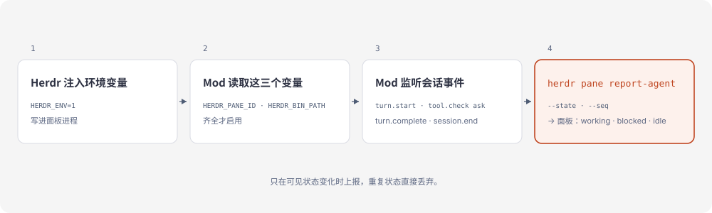

# 工作原理

Herdr 把 `HERDR_ENV`、`HERDR_PANE_ID`、`HERDR_BIN_PATH` 写进它启动的进程。Mod 在第一次钩子调用时读这三个变量，齐全才建 adapter。此后每个钩子只做观察，事件原样放行。

面板状态不是事件的流水账，而是两个事实的函数：**这一轮是否在跑**，以及**有没有正在等你的决定**。事实只由保证会到达的事件驱动：`classic.UserPromptSubmit` 与 `turn.start` 开始一轮，`classic.Stop` 与 `turn.complete` 结束一轮；工具结算从不结束一轮，所以漏掉轮次事件最坏是停在 `working`，不会谎报 `idle`。等待项按 `tool_use_id` 记在集合里，由该工具的 `classic.PostToolUse`／`tool.call` 结算、`classic.PermissionDenied` 或轮末 `Stop` 清除。状态或文案变了，才发一次 `herdr pane report-agent`，带上面板、状态和单调递增的 `--seq`；没被接受就重试，三次都失败则把这条记为未确认，等下一个事件补发。侧栏的状态由此而来，重启后还能用 `codebuddy --resume <id>` 把会话接回来。

## 面板显示什么

| CodeBuddy 事件 | 上报给 Herdr 的状态 |
| --- | --- |
| `session.start` | `idle`，附带会话 ID 与 `codebuddy --resume` 命令；读屏命中阻塞界面则报 `blocked` |
| `classic.UserPromptSubmit` | `working`：人刚提交了任务，这一轮从这里算起。`turn.start` 被采样漏掉也不影响 |
| `turn.start` | `working` |
| `classic.Stop`／`StopFailure` | `idle`：引擎保证会发的轮末信号，清掉还挂着的等待项；`Stop` 的 `last_assistant_message` 收尾在提问则报 `blocked`；轮末读一次屏，命中对话框（含登录门槛）则报 `blocked` |
| `tool.check` → `ask` | `blocked`：有权限确认在等人处理，带 `--message waiting for permission`；按 `tool_use_id` 记录 |
| `tool.call` → `AskUserQuestion` | `blocked`：模型自己的提问在等人回答，带 `--message answer the question`；非 PTC 会话在这一步就拦住 |
| `classic.Notification` → `permission_prompt` | `blocked`：引擎在等待前发出 `needs your permission to use <tool>`；PTC 提问、计划批准都在这时拦住 |
| `classic.PostToolUse`／`PostToolUseFailure` / `tool.call` 结算 | 清掉这一次调用的等待项，回到 `working`；轮外（别的 Mod 用 `$.ui.ask` 提问）回 `idle` |
| `classic.PermissionDenied` | 拒绝之后不再有工具结算，这里按 `tool_use_id` 清掉这次调用挂的等待；同时等着的其他确认不受影响 |
| `turn.complete` | `idle`：`reason` 为 `answer` 且回复收尾在提问（`answer` 字段）则报 `blocked`（`answer the question`），`Stop` 的 `last_assistant_message` 兜同一份判定；轮末不读屏，下一次 `UserPromptSubmit` 清除 |
| `session.end`（`clear`、`resume`） | `idle`：进程比这次对话活得久；读屏命中则报 `blocked` |
| `session.end`（其他情况） | 释放 agent |

子 agent 的 turn 循环被忽略：只要主轮还在进行，面板就算忙。但子 agent 的权限确认照样报 `blocked`，等的是同一个人。

`--seq` 取「上一条 + 1」和当前时间的较大值。Herdr 每个面板按来源只认更高的 `--seq`，所以同一个面板里如果有另一个进程（例如在面板里跑起来的 `codebuddy -p`，它继承了 `HERDR_*`）报过状态，本进程的下一条上报仍然能压过它，面板不会被永久锁在别人的旧状态上。

## 屏幕兜底

Herdr 的检测清单不能直接给 CodeBuddy 用：官方文档写明，新增一个它不认识的 agent 仍需要 Herdr 二进制更新，本地 manifest 只补规则。所以这一步放在 Mod 里。

每次准备报 `idle`（`session.start`、`session.end` 的 `clear`／`resume`，以及每一轮的 `classic.Stop`），Mod 用 `herdr pane read <pane> --source detection` 读一次 Herdr 屏幕检测用的底部快照，只跑对话框规则：权限确认、`AskUserQuestion`、计划批准（`Ready to code?`）、工作流确认、登录门槛（`Select login method`／`Waiting for auth`）。规则要求标题和选项行同时出现在面板底部；转写区里的历史文字不算。命中就报 `blocked` 并带 `--message`（`waiting for permission`、`answer the question`、`approve the plan`、`approve the workflow`、`sign in`），没命中、读失败或 Herdr 版本太旧都回退 `idle`。轮末读屏只认对话框：面板上的自由文本永远不算阻塞，轮末提问的判定仍来自回复文本。每次读超过 1.5 秒算失败，失败后这个进程不再读屏。中文规则按现有审批文案尽力匹配；2.183.0 的 TUI 本身是英文，中文属于预防性覆盖。

## 轮末文字提问

`classic.Stop` 的 `last_assistant_message` 和 `turn.complete` 的 `answer` 是同一段话，两个事件互为备份：哪一个被采样漏掉，另一个都能让这条判定成立。`turn.complete` 的输入带 `reason` 和 `answer`：`answer` 是本轮最终的可见回复文本。`reason` 为 `answer` 时，Mod 只看 `answer` 最后三行；以问号收尾，或命中「回复／请确认／确认后／逐条改」这类词表，就报 `blocked`（`answer the question`）。这里不读屏：任务行、TUI 文案和滚动历史都不进这条判定，后台任务还在跑时也不会误报；`aborted`、`refusal`、`error` 收尾一律回 `idle`。

## 等待前的通知

PTC 会话里模型提问由 REPL 工具内部的 AskService 承接：引擎先停在 `waitForPtcQuestion`，等人答完才执行内层工具、触发 `AskUserQuestion` 的 `tool.call`。等待前引擎会先走一遍 `onWillPrompt`，发出 `classic.Notification`（`notification_type` 为 `permission_prompt`，消息是 `needs your permission to use <工具名>`）。

2.182 及更早版本里，Mod 收不到这条通知：`HookManager.hasHooks` 不把 Mod 注册的 classic 钩子算进去。2.183 加入了 `modsClassicHookExists`，注册 `classic.Notification` 的 Mod 会让 `hasHooks` 为真，通知在等待前就到达。Mod 只认 `needs your permission to use ` 前缀，`AskUserQuestion` 报 `answer the question`，`ExitPlanMode` 报 `approve the plan`，其他报 `waiting for permission`。不用 `notification_type` 单独判断，是因为 `$.ui.notify` 也会落成 `permission_prompt`。

## 为什么开销低

钩子跑在 CLI 进程里，每个事件都不另外启动 shell 或 Node 钩子进程。上报按状态和文案去重，一轮里五十次工具调用只发一次 `working` 和一次 `idle`。等待前的通知直接来自引擎事件，轮内不再读屏；每次 idle 转变（含轮末）读一次检测快照，约 250ms，读屏和上报都在后台，这一轮从不等待 Herdr。

用 CodeBuddy 的 hooks（事件触发的外部脚本）实现同一件事，每个事件都要起一个 Node 进程，再由它调用 herdr，一轮五十次工具调用就是上百次进程启动。这个 Mod 只在可见状态变化时 spawn 一次 herdr，外加每次 idle 转变一次读屏。

## 相关 ADR

- [0001-socket-first-transport](adr/0001-socket-first-transport.md)
- [0002-mod-sandbox-cli-transport](adr/0002-mod-sandbox-cli-transport.md)
- [0003-screen-blocked-detection](adr/0003-screen-blocked-detection.md)
- [0004-poll-while-working](adr/0004-poll-while-working.md)（已被 0005 取代）
- [0005-prompt-notification](adr/0005-prompt-notification.md)
- [0006-prose-question](adr/0006-prose-question.md)（已被 0007 取代）
- [0007-turn-answer-not-screen](adr/0007-turn-answer-not-screen.md)
- [0008-turn-facts-and-delivery](adr/0008-turn-facts-and-delivery.md)
- [0009-turn-end-reads-for-dialogs](adr/0009-turn-end-reads-for-dialogs.md)
